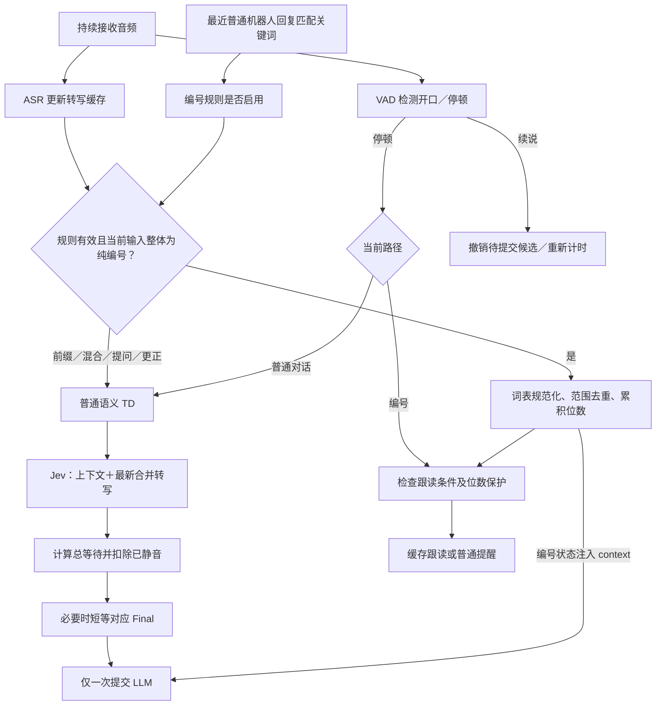
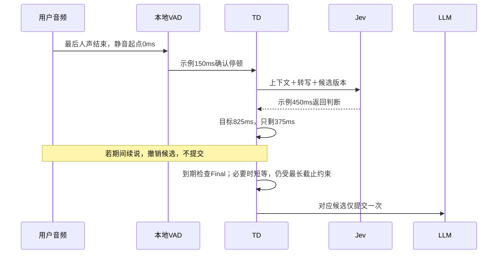
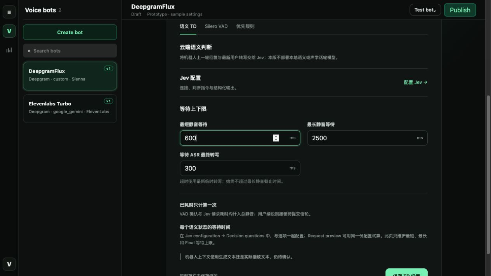
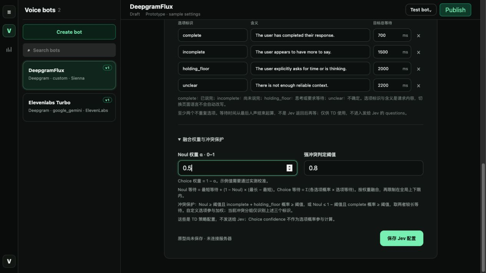
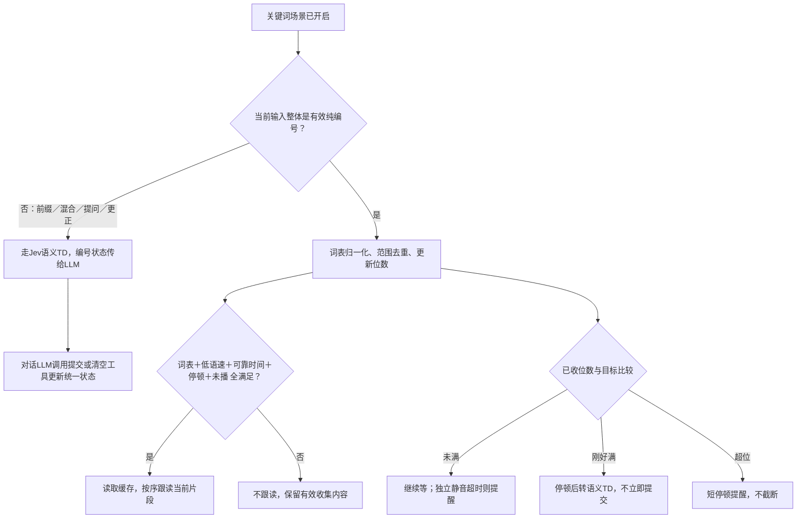
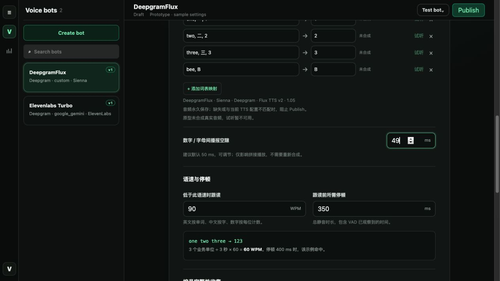
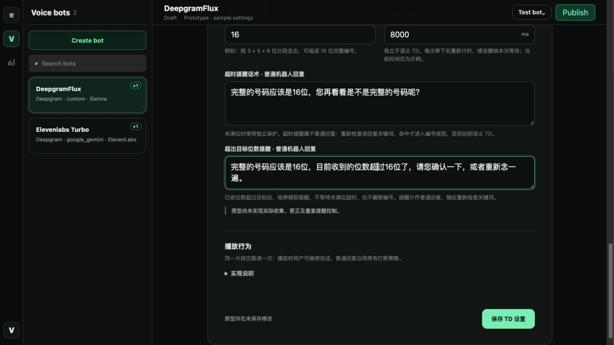
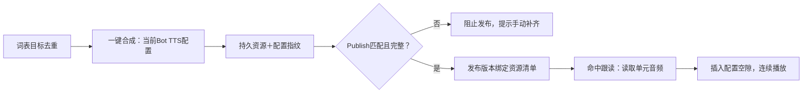

# 附录：语义 TD、VAD 与编号跟读规则

返回 [核心设计](../design.md) · [打开当前原型](http://127.0.0.1:8767/prototypes/index.html)

本附录整合最新讨论，解释“怎么运行、在哪里配置”。原型是模拟页面；图中的状态机、调用和缓存均不代表正式实现已完成。**最新业务规则已确认，产品开放问题0项；自测范围已由D-045确认，见[自测计划](../verification/self-test-plan.md)。原型v0.14已同步，待用户确认后冻结。**

## A．运行总流程

**本地严格校验整体编号格式，不再从混合句抽取数字。** 关键词有效时，纯编号输入本地收集并按既有条件跟读；“我的号码是123”“不是123，是124”“123，接下来还要几位”等整句进入Jev普通语义TD及现有对话LLM。LLM判断正常提供编号后调用提交工具，判断更正后调用清空工具；本地不靠堆更正正则理解意图。工具与本地共用一份编号状态，失败不能口头宣称成功。详见[更正与注意事项](corrections-and-cautions.md)。

### 谁保存什么

| 角色 | 负责 | 不负责 |
|---|---|---|
| ASR 适配器 | 原始事件 → 转写范围、版本、稳定前缀、可变尾部、时间戳 | 自建模式下不能直接提交 LLM |
| Silero VAD | 人声开口、候选停顿、续说；本地音频时钟 | 判断语义完整与编号位数 |
| 编号状态 | 当前内容、已收/目标位数、收集代次、跟读位置 | 自己生成普通回答 |
| Jev | 判断是否交出话轮及表达状态 | 修改编号或输出最终等待时长 |
| 统一 TD | 分流、计时、失效旧结果、最终提交一次 | 再做一遍识别 |
| Pipeline／LLM | 拼上下文、回答问题；通过工具修改编号 | 仅口头声称状态已修改 |
| 音频输出 | 读取发布版本素材、按序播放；读取失败按已确认策略临时合成留痕 | 正常缓存命中仍重复合成 |

## B．VAD 与普通语义 TD

### B1．何时请求、何时回复

1. ASR 持续更新缓存：同范围 Partial 覆盖旧 Partial，Final 分块累积；给 Jev 的是当前完整合并文本，不是厂商最后一包。
2. VAD 达到“候选停顿确认时间”后，创建候选及版本；普通路径发送最近机器人回复、当前用户转写及其 Partial/Final 状态给 Jev。
3. Jev 返回后，TD 换算目标总静音时间；VAD 确认与请求耗时都已计入静音，不重复追加。
4. 到目标时间时，已有对应 Final 就提交；否则短等 Final，超时用最新非空 Partial。全过程不突破普通路径的最长静音截止。
5. 用户续说撤销候选；旧 Jev / 旧范围 Final 不能结束新的话语。最长截止有独立看门狗，不依赖 Jev 必须成功返回。

ASR Final 只表示相应音频范围的文字已确定；Jev Choice 的 `complete` 只表示表达状态；两者都不等于已经提交 LLM。空转写不伪造成用户话语；与现有无识别结果处理的衔接由工程核对，不擅自新增提醒。

### B2．等待计算

| 量 | 解释 |
|---|---|
| Noul 值 p | 0–1，越高表示越可能交出话轮 |
| TN | 最短等待 ＋ (1−p) ×（最长等待−最短等待） |
| TC | 各 Choice 选项的“概率 × 该选项目标等待”之和 |
| α（阿尔法） | 人工配置的 Noul 权重，范围0–1；Choice 权重为1−α，不是Jev返回的概率 |
| 目标总等待 T | α×TN＋(1−α)×TC，再限制在最短/最长之间 |
| 还需等待 | max(0，T−当前已静音时长) |

**配置位置：** ASR来源选择Self-developed后，Advanced → 话轮检测 → 语义TD → 配置Jev → 判断问题 →「融合权重与冲突保护」→「Noul权重α」。原型字段为 `fusion-alpha`，示例值0.5：Noul和Choice各占50%；0.8表示分别占80%和20%。越接近1越偏向TN，越接近0越偏向TC。该参数由TD用于本地等待计算，不发送给Jev。

强冲突时取 TN、TC 中较长值，再应用上下限。原型分组为 complete 对 incomplete＋holding_floor；自定义选项参与 TC，但其冲突角色不自动猜测。概率总和必须为1；confidence 不冒充选项概率。异常结果不能计算有效等待时，最长保护仍有效。

**例：** 最短600、最长2500ms；p=0.9；complete概率0.8/等待700ms、incomplete概率0.2/等待1500ms；α=0.5。得到 TN=790、TC=860、T=825ms；Jev返回时已静音450ms，只需再等375ms。数值均为示例，不是校准结论。

### B3．原型入口与字段

入口：Bot settings → ASR配置 → 来源选择 **Self-developed** → Advanced → 话轮检测。来源切回厂商原生/Off，隐藏自建配置，保留 General 通用设置。当前四家六模型均需支持自建来源；原型v0.14已将AssemblyAI修为universal-3-5-pro；真实运行时兼容仍待验证。

| 页面 / 字段或按钮 | 用途 |
|---|---|
| 语义 TD：最短静音 | 普通语义路径不得早于此时间提交 |
| 最长静音 | 无论 Jev 是否超时，达到截止提交已有非空文本；不适用于未满位收集的独立保护 |
| 等待 ASR Final | 决定提交后短等确定转写；超时用最新Partial，不延长最长截止 |
| 配置 Jev | 进入连接、判断问题、请求预览/试算独立页 |
| Jev连接：地址、模型、密钥、超时 | 正式实现由后端请求并安全保存凭证；超时不延长TD截止。原型不测试真实连通 |
| Noul 判断指令 | 结合上下文判断用户是否已交出话轮，不只看标点或短停顿 |
| Choice 选项、含义、目标等待 | 行内维护分类及等待映射；等待属于TD配置，不发送给Jev |
| Noul权重α、强冲突门槛 | 控制两种判断怎样融合；0.5/0.8仅示例，仍待评测 |
| 添加 / 删除Choice选项 | 同步维护该选项含义及目标等待；概率试算使用同一配置 |
| 检查配置 / 保存配置 | 当前原型仅校验字段、保存页内状态；不代表已连通或服务器已持久保存 |
| 请求预览与试算 | 查看无密钥请求体，手填模拟概率，检查总等待和剩余等待；不代表真实模型输出 |

| Silero VAD 字段 | 作用与取舍 |
|---|---|
| 候选停顿确认时间 `stop_secs` | 静音持续多久才报候选；越短越早请求，也越易触发碎片停顿。页面以ms展示 |
| 开口确认时间 `start_secs` | 人声持续多久确认开口/续说；越短撤销等待越快，也更易误触发 |
| 人声概率阈值 `confidence` | 0–1，越高越严格，轻声可能漏检 |
| 最低音量 `min_volume` | Pipecat归一化值0–1，不是分贝；过高可能过滤轻声 |

VAD参数不等于最终回复等待。时间戳是否可用由工程验证；四家字段和现有适配缺口见[专项表](asr-event-mapping.md)。

## C．编号收集与优先跟读

### C1．先收集，再决定是否跟读

按最近普通机器人回复的整段生成内容匹配，任意一个关键词命中即开启规则候选；不依赖其实际播放进度。机器人关键词为必需入口，不再提供跳过关键词检查的独立开关；命中后仍需对整体输入通过严格编号格式校验并满足后续条件，不能单靠关键词收集或播放。用户分段和规则跟读不刷新该关键词上下文；新的普通回复、超时提醒、超位提醒需要重新匹配关键词。同一未完成采集在提醒后再次命中关键词仍保留编号并继续累加；成功后下一次启动新采集则清空旧值并换代。第一版用户要求局部更正也直接调用清空工具，不执行局部替换，不先追问。

- 有效编号单元可累积；**念得快只是不跟读，不应丢掉已经识别的有效编号。**
- 跟读条件同时满足：当前规则有效、片段命中词表、可靠时间可算 WPM、WPM低于阈值、停顿达到阈值、片段未被重复处理。
- 连续指相邻命中的编号单元，中间没有非编号内容打断；**2位也算一个连续片段**，不是最低凑到3/4/5位。沿用不设最低片段位数的设计，单个有效单元也可作为候选。识别出2位不立即播放，仍须低速、可靠时间和停顿全部达标。
- “我的号码是12”“123，嗯，45”均属于混合表达，整句走Jev→对话LLM，不先提取数字或用整句时长计算编号WPM；正常编号由受控工具提交。完整编号目标位数仍是另一项配置。
- 英文按单词、中文按字、数字逐位计数；1234算4个业务word，不由ASR分词数量决定。WPM=片段业务word数×60÷片段首尾音频时长（秒）。

图中两项检查共享收集状态；提取和累积是本地路径，未满位编号无需先请求Jev。超位提醒优先：尚未开始的末段跟读不入队；若该段已开始播放，先让其播完，再播放提醒。范围/版本去重防止同一事件重复排队，不允许两段机器人音频叠播。

### C2．三种边界与普通提问

| 输入/状态 | 处理 |
|---|---|
| 未满位 | 保持收集；每次最后人声结束后重新计连续静音，达到独立保护时播放未满位话术 |
| 刚好满位 | 先等停顿，再进入语义TD；第N位出现不立即抢话 |
| 超位 | 短停顿播放超位话术；不套用未满位超时、不静默截断。短停顿具体值由工程提出校准建议 |
| “现在几位了？”等普通问题 | 本次跳出编号等待路径，正常语义TD；Pipeline给LLM编号、已收/目标位数等context |
| “嗯……我的号码是12345” | 整句走Jev与对话LLM；正常编号经提交工具更新，工具成功前不累加、不本地跟读 |
| “不是123，是124” | LLM识别更正后调用清空工具，成功后提示完整重念；不收123124，也不直接改成124 |
| 相同数字真实重复念 | 按不同音频位置保留，例如11算两位，不按字符串去重 |
| 相同Partial重复回包 | 同范围/版本更新，不重新累积或跟读 |
| 清空/更正/重念请求 | 正常对话理解；明确清空或局部更正请求都调用清空工具，Pipeline清空已有编号；第一版不局部替换，也不先追问 |

清空工具的触发范围已确认，**尚未开发**：用户明确清空或要求更正（包括“把第4位改成3”），由LLM调用本地工具，Pipeline清空当前会话编号、复位计数、失效旧代次和待播旧片段，保留目标/词表配置。工具成功后才能回复已清空，并说明需重新念完整编号；不会自动把指令中的3追加为新编号。普通提问/让机器人复述不因为包含数字就触发清空。

### C3．紧凑原型与字段

| 字段/按钮 | 用途 |
|---|---|
| 优先规则开关 | 开启后，在有效编号场景优先处理；不是让所有普通话语都进入编号等待 |
| 机器人关键词 | 按最近普通回复整段生成内容匹配，任意一个命中即可；必须启用此门槛。旧截图中的独立关闭开关待移除 |
| 识别词列表 | 每行逗号分隔，例如one、一、1，共同映射目标1；重复别名冲突需要修正 |
| 跟读内容 | 规范化目标值，也是缓存音频对应的播报单元 |
| 行内状态/试听 | 显示该目标音频是否可用，试听当前配置的真实音频；无音频则禁用 |
| 添加 / 删除词表行 | 维护一组识别别名与目标；别名冲突或空值不能保存/合成 |
| 一键合成 | 去重目标后批量准备当前Bot TTS音频；失败可定位，原型只校验词表，不真实合成 |
| 数字/字母间播报空隙 | 建议默认50ms，相邻单元之间插入；改间隔不重合成，重复数字仍按次数播放 |
| WPM阈值 / 跟读前停顿 | 同时约束跟读速度和开始播放时机，不决定有效编号是否被收集 |
| 编号完整性开关 | 启用目标位数与对应提醒配置；字段关闭时不要求填写。正式状态行为按该配置实现 |
| 完整编号目标位数 | 例如16位；不限制一次跟读片段长短 |
| 编号收集等待保护 | 未满位时的独立连续静音截止，用户续说撤销本次计时 |
| 未满位超时话术 / 超位话术 | 两项独立编辑；都是普通回复，播后重新按该回复检查关键词 |

## D．缓存、播放与发布

音频永久保存，不依赖前端内存，也不因新会话自动清理。更换声音、模型、语言、有效语速等会让旧资源与新配置不匹配，但不自动删除旧文件；改间隔不失效。Publish只检查，不自动收费合成。

工程上统一采样率/格式后拼接，不能直接拼压缩文件头，也不使用阻塞等待制造间隔。同一机器人音频输出使用串行队列；用户可同时说话不等于两段机器人跟读互相叠播。待播片段带范围/代次/版本，重复包不重复入队，旧结果不回填已清空状态。

发布后读取缓存失败时，临时调用TTS合成后跟读；使用发布版本的跟读声音/语速，普通回复动态改语速不改变缓存数字的语速。会话记录必须显示缓存读取失败、临时合成及成功/失败结果和额外耗时，不能伪装为缓存命中。素材头尾可能自带静音，50ms是额外间隔，真实听感与延迟需实测。

## E．三类等待对照

| 等待 | 从哪里计时 | 结束条件 | 续说后 |
|---|---|---|---|
| 跟读前停顿 | 当前用户片段最后人声结束 | 停顿达标且其余条件全满足，才跟读 | 播前候选更新；已播放跟读不因用户续说被取消 |
| 未满位保护 | 本次最后人声结束 | 未满位且独立保护到期，普通提醒 | 撤销当前计时，下次停下重新开始 |
| 普通语义等待 | 当前语义候选最后人声结束 | Jev策略到期＋必要的有界Final等待；最长截止兜底 | 候选失效，旧Jev/Final不再提交 |

超位短停顿的具体数值/复用方案由工程准备校准建议，不影响已确认的提醒优先顺序。所有耗时都在同一音频时钟下核算，不拿网络消息接收时间伪造发音时长。

## F．每轮记录与异常

Sessions继续使用线上列表/详情抽屉；逐Turn保留用户、普通机器人回复、原有延迟指标，再折叠展示TD证据。一轮多次停顿对应多次判断，不产生多次普通回复。厂商原生旧会话没有Jev证据时明确缺失，不回填模拟概率。

| 事件 | 规则/工程要求 |
|---|---|
| Jev超时、无有效结果 | 普通路径仍由独立最长截止兜底，不无限等 |
| Final迟到或只覆盖旧片段 | 只更新对应范围；不能清掉新Partial或触发第二次回复 |
| 时间戳缺失、反序、连接时钟不同 | 工程记录并修复；无法证明WPM就不触发该次慢速跟读，不猜测 |
| 用户主动更正 | 正常语义对话后调用清空工具，不做局部替换、不先追问，不把指令内数字追加进编号 |
| 已播放后ASR自动改字 | 补读更正内容；保留原播内容、修订内容与补读记录，同一修订重复回包不反复补读 |
| 缓存不齐 | 发布前阻止；发布后读取失败临时TTS补合成并留痕，不伪装已命中缓存 |

### 确认与实现状态

- **产品确认：** 原9项已由用户逐项确认；本轮新增边界另见open-questions，见[确认原文](../decisions/confirmed-questions-20261020.md)和[决策D-026～D-034](../decisions/decision-log.md)。
- **文档已同步：** 自动补读、整段生成内容/任一关键词/必需门槛、提醒后保留编号、局部更正清空、超位提醒优先、缓存失败临时合成留痕、跟读固定发布语速。
- **工程仍待实施：** 原型v0.14已去除独立关键词开关并更新示例；工程尚需完成ASR适配、状态机/工具、串行队列/修订补读、缓存/发布检查、运行时临时合成与逐Turn记录，详见[tasks](../tasks.md)。具体参数由工程校准后给建议，不把现有示例值冒充已确认默认。
- **未验证：** 真实Jev/TTS、时间戳覆盖、补读/提醒并发、缓存异常、音质与延迟。产品规则确认不是实现/验收通过，也不是本轮付费测试授权。

本页旧截图保留为历史示意，可能含旧开关或文案；当前v0.14截图与改动对照见[候选修正记录](../verification/prototype-v014/changes.md)，旧图不能替代最新候选或用户确认。历史过程见[history/design-history.md](../history/design-history.md)。

## G．本轮反馈与自测范围（2026-10-20）

- 成功采集后，下次新采集清空旧值并换代；同一未完成采集的提醒不清空。见D-037。
- D-038的同句先本地抽取已被严格分流替代：同句编号＋问题走LLM工具；已独立收集/跟读的纯编号不因后续提问重复入库。one moment仍不作为编号。
- “不是123，是124”已确认更正清空并要求完整重念；Q-038已闭环。正常混合提供编号需受控提交工具。
- 新增[SDD/TDD自测范围与逐项解释](../verification/self-test-plan.md)、[播放冲突填写表](../decisions/playback-decisions.md)。方案建议不是已确认行为，当前未开始核心实现或真实调用。

## H．更正与注意事项（最新确认）

完整说明见[更正与注意事项](corrections-and-cautions.md)。纯编号本地收集，混合表达走现有对话LLM并调用提交/清空工具；不再从带前缀句子直接抽数字，不堆更正正则。流式修订、工具失败、来源去重及共用状态是必测项。播放行为以已填写表为准，特别是P03=B；普通回复后的迟到改义已按D-043确认停止旧回答并重答；Q-039已关闭。
