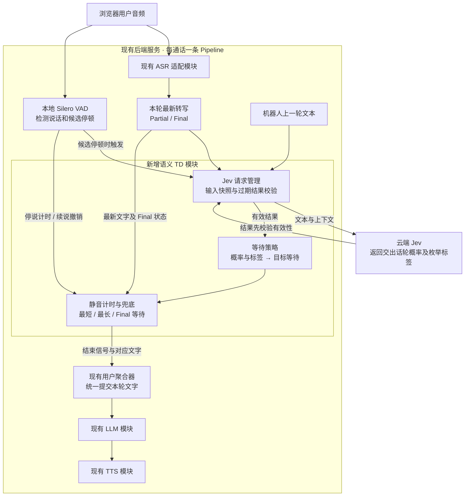
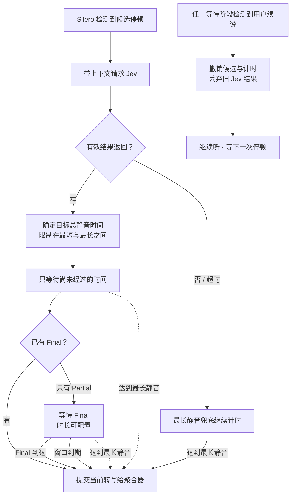

# 历史细节稿（仅供追溯）

> 本文是早期设计快照，不是当前行为依据；下文“待确认”、旧流程及参数描述均为历史状态。当前设计以[核心设计](../design.md)、[整合附录](../appendices/behavior-details.md)和[决策记录](../decisions/decision-log.md)为准；当前产品待确认问题为0。保留原文用于追溯，禁止据此恢复已关闭问题。

## Existing flow
`src/pipeline/voice_agent.py` 内部创建 ASR、用户聚合器、LLM 与 TTS。轮次控制器位于 Pipecat 聚合器。主规格目前只定义 provider_native/off。新增模式必须显式适配厂商边界，不得把普通分块 Final 等同于整轮结束。

## Proposed data flow
音频 → 本地 Silero VAD；音频 → 已有 ASR；候选停顿 → Jev 异步判断；Jev 结果 → TD 等待策略 → 已有用户聚合器 → LLM。

Jev 的 state 提供明确角色：previous_assistant_text、current_user_transcript、transcript_kind、业务判断说明；不发送原始音频或整份系统 Prompt。上一轮助手文本在打断时取完整生成文本还是实际播放部分，仍待确认，不能静默沿用旧上下文规则。

建议的输出语义：p_yield（用户已准备交出话轮的概率），reason（如 complete / incomplete / holding_floor / unclear）。这些是待验证的产品字段，需按 Jev 官方 question 类型分别建模，不能假设是现成接口字段；标签是判断结果，不是可信解释或思维链。

## One clock, one deadline
以服务端音频样本时钟记录候选最后人声位置 t0，不使用浏览器不同时钟直接相减。VAD 实际位置估计与事件发出时间分开记录；不能盲减配置的 stop_secs 以冒充精确声学边界。

目标总静音 T = clamp(policy(p_yield, reason), Tmin, Tmax)。有效结果到达时剩余等待 = max(0, t0 + T - now)。这样 VAD 确认时间与 Jev 往返耗时已经包含在 elapsed 内，不重复扣减。若请求耗时超过目标，最早只能在结果到达后决策；补偿无法消除真实网络延迟。

最长静音 watchdog 与 Jev 请求独立运行，不能等 Jev 返回才启动。Tmin/Tmax 都指一次连续静音，不是整轮总时长；用户续说重置候选，不因长句达到 Tmax 而截断说话。

## Stale result protection
每个请求绑定 session、turn、speech_generation、transcript_revision。VAD 确认新语音后立即撤销待提交计时、递增 generation，取消可取消任务；迟到结果必须丢弃。静音中转写修订也会使旧结果失效，应合并修订后再请求，不对每个 Partial 无限制调用。请求频率、空文本行为、超时和重试成本需要确认。

提交必须同时校验仍静音、候选仍有效、有可提交文字、未提交过。文字聚合复用现有机制；自建模式下原生 EOT 可以保留作分段证据，但不能旁路触发 LLM。各厂商增量文字能力与实际支持范围必须单独核验。

## Timing example (illustration only)
最后人声在 0ms；VAD 事件在 150ms；Jev 在 450ms 返回；策略目标为总静音 700ms，则仅再等 250ms。以上数值仅用于解释计算，不是默认参数或性能实测。

## Verification plan
离线假时钟覆盖续说、迟到、修订、超时、空文字、重复事件、最短/最长边界；fixture/mock 不证明 Jev 判断质量。真实验证先用获批合成文本，记录模型固定版本、语言、P50/P95 往返、误截断和调用量。实际客户数据或付费 API 测试需单次明确授权及费用上限。

## Official source
https://api.typesafe.ai/redoc — questions/state 接口；https://typesafe.ai/blog/introducing-system-one-models-and-jev — 决策模型及延迟条件。尚未调用，不引用非官方同名站点作为接口依据。

## Confirmed fallback — 2026-10-20
连续静音达到 Tmax 时提交已有文字，不再等待 Jev；正常语义结束候选只有 Partial 时短等 Final，超时用最新 Partial。Final 等待不得突破同一 Tmax 硬上限。无文字、Final 的协议内含义、具体等待时长及提交后的迟到修订处理仍属详细策略待定，不默认修改已发出的 LLM 请求。

## Configurable Final wait — 2026-10-20
Final 等待时长为独立配置项（候选名称 final_wait_ms），不是固定常量。仅在 TD 已允许交出话轮但转写仍为 Partial 时启动；VAD 候选停顿本身不启动此窗口。Final 提前到达则立即结束此等待，仍校验候选有效和最短静音要求。最终截止时间取“窗口启动时间 + 配置时长”与“最后人声位置 + Tmax”较早值。到期使用当时最新非空转写；续说撤销窗口。配置入口、取值范围和默认值待确认，尚未新增 UI 或运行配置。

# 补充：详细架构与决策流程

## 1. 架构：各模块负责什么

图中 ASR、LLM、TTS 是现有服务内的适配模块，实际厂商调用不变。**只把 Jev 放在云端，不部署本地语义模型或 Smart Turn。**

## 2. 决策：用户停顿后发生什么

**所有提交都必须仍处于静音、存在非空文字、候选未过期且尚未提交。** 空文字处理尚待确认。静音中转写发生修订时，旧 Jev 判断失效，重判频率待定。

## 3. 计时：耗时算进去，不重复等

**剩余等待 = 目标总静音时间 − 从最后人声位置起已经过的时间，最小为 0。**

| 示例时间点 | 发生什么 |
|---|---|
| 0ms | 用户最后人声结束，静音计时起点 |
| 150ms | VAD 确认停顿，发起 Jev 请求 |
| 450ms | Jev 返回，策略决定总共等 700ms |
| 700ms | 再等 250ms 后满足结束时间；若仍只有 Partial，再进入受上限约束的 Final 等待 |

以上只是计时示例，不是已确认默认值。最长兜底从最后人声位置独立计时；云端耗时无法被补偿消除。

## 4. 三个等待配置

| 配置 | 负责什么 |
|---|---|
| 最短等待 | 防止过早交出话轮 |
| 最长等待 | 达到就提交已有文字，不再等 Jev 或 Final |
| Final 等待 | 允许结束但只有 Partial 时，短等 Final；到期用最新 Partial |

这三个参数与 VAD 自身的候选停顿确认时间不同。配置入口、默认值和范围待确认。

