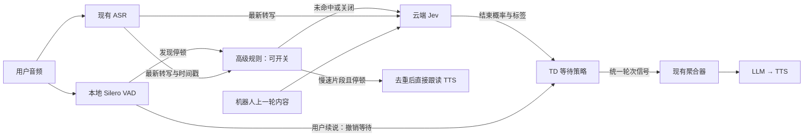

> 历史效力说明：本文保留各版本原文；其中“待确认”及已替代方案不代表当前未决问题。当前产品待确认问题为0，以[核心设计](../design.md)、[整合附录](../appendices/behavior-details.md)和[决策记录](../decisions/decision-log.md)为准。

# 核心设计历史记录（仅供追溯）

以下保留截至2026-10-20的设计演进，包含被后续决定替代的版本。当前简版见 [design.md](../design.md)，整合规则见 [附录](../appendices/behavior-details.md)。此文件不作为当前默认行为的定义。

# Jev 语义 TD：核心设计（草案）

**本地 VAD 找停顿，云端 Jev 判断意思，TD 决定何时回复。**



图中连线表示职责和数据流：停顿触发的 Jev 请求、结果有效性校验由后端 TD 模块管理；不会把音频直接发给 Jev。

## 高级跟读规则（新增草案）

**开启后优先于 Jev：满足已启用的机器人关键词条件后，用户慢速念完一段连续数字／字母并停顿，才触发跟读。跟读期间用户可以继续说，不打断这段跟读。**

**片段长度由用户实际输入和停顿决定：三位、五位或其他长度均可，不固定，也不提供“每次跟读片段位数”配置。完整编号的目标位数另行配置，见下文编号收集。** 下文 N 仅代表本次片段实际单元数量。

| 步骤 | 行为 |
|---|---|
| 机器人上下文 | 可选配置机器人关键词，限定提示后的跟读场景；例如“请逐位念出编号”。匹配范围、组合与失效规则待确认 |
| 识别内容 | 建议先用确定性词表转成单元，再用正则识别连续数字／字母片段；不是再调用模型 |
| 计算速度 | 自定义 WPM：英文一个单词算 1 word，中文一个汉字算 1 word，数字每位算 1；`hello` 算 1、`你好` 算 2、`1234` 算 4，不采用 ASR 的分词数量 |
| 命中条件 | 已配置的机器人关键词条件满足、连续数字／字母片段、WPM 低于阈值、有可靠 ASR 片段起止时间、且达到可配置的跟读停顿时长；WPM 阈值可配置，具体默认值待定 |
| 跟读输出 | 已确认指定片段只跟读一次；直接 TTS 路径为建议设计，跟读不等于提交整轮给 LLM |
| 用户续说 | 播放前续说则暂缓的建议需结合分组策略冻结；播放后用户可同时说，不取消正在播放的跟读，继续接收 ASR |

建议词表例子：`one → 1`、`two → 2`、`bee → B`，再检查是否为连续数字/字母片段。`bee` 也可能是普通单词，因此同音映射需限制在编号采集场景，不能全局替换；该边界待确认。

WPM 的计数口径与跟读匹配范围分开：普通英文单词不会仅因计作一个 word 就自动成为编号跟读对象；同音映射仅改变候选解释，不重复累计单元。逐字母拼读及其他语种的具体计数规则待确认。

WPM = N × 60 ÷（第 N 个单元结束时间 − 第一个单元开始时间，单位秒）。这是 N 个业务单元的速度，不是 ASR 分词速度。N 位合并为一个 ASR token 时，整体时间区间足够则可计算；跨分组但无法拆分时间戳时不能平均虚构单字时长，应标记证据不足，工程补齐边界。

去重按已处理内容片段维护，不按收到几次 Partial 计数；文字修订与重复数字组需结合位置、轮次识别，不得仅按字符串全局去重。用户主动更正走普通对话；仅“已播后ASR自动改字是否补播”留Q-004，工程版本/去重/串行队列见asr-event-mapping.md第9节。**跟读为不被用户续说打断的特例，不代表普通 LLM/TTS 回复一律关闭打断。**

## 高级规则配置与时间口径

采用**一个 TD 高级规则配置页，按区域组织**，不把词表、WPM、停顿各拆为独立页面。上线前可调；上线后可以隐藏普通用户入口，后台仍保留调整能力。页面入口和可见性具体方案见后文建议，不在本轮冻结。

| 区域 | 配置或展示内容 |
|---|---|
| 规则开关 | 开启后优先判断跟读，未命中再进入 Jev；关闭则不运行跟读判断 |
| 机器人关键词 | 可配置触发提示词，例如“编号”“逐位念出”；未配置时是否不作限制、多个词的任一/全部关系及生效窗口待确认 |
| 数字／字母词表 | 原词、目标数字/字母、语言/适用场景；支持维护同音映射，具体格式待确认 |
| WPM 条件 | 配置低速阈值；同时展示英文按词、中文按字、数字逐位的计数口径 |
| 跟读停顿 | 独立配置跟读前要求的连续静音时长，与 Silero 的 `stop_secs` 分开 |
| 对话统计 | 对每个评估片段显示原转写、实际单元数、时长、WPM、停顿及命中/未命中原因 |

**ASR 时间用于算语速，VAD 时间用于算停顿：**

- `start/end` 是目标 ASR 片段第一项开始、最后一项结束的音频时间戳，不是 VAD 事件的接收时间；分词数量仍由业务计数规则决定。
- 跟读停顿从 VAD 估计的最后人声位置累计；收到候选停顿时已过去的时间计入，不在 `stop_secs` 后再完整追加一次跟读停顿时长。
- WPM 统计在本次片段内计算，不使用整场对话平均值代替；没有可靠时间戳时显示“无法计算”，不得显示猜测数值。时间戳由工程检查与接入；缺乏可靠时间时无法满足慢速跟读条件，不猜测WPM。

### 最近一轮回复与误切分保护（已确认核心规则）

已确认关键词只匹配最近一轮机器人回复。该回复保存为稳定关键词上下文快照，ASR 分块、用户 TD 边界及 Partial/Final 更新不替换快照；用户在同一提示后被切成多段，仍使用同一提示。跟读输出标记为规则回声，不覆盖普通助手提示快照，避免读回数字后关键词失效。正常机器人回复的整体输出作为新快照，而非每个流式文本块一轮。

如果误切分已触发新的普通回复，单靠快照无法判断哪一轮正确：建议沿用普通打断/生成取消机制，不回查历史关键词自动恢复采集；是否恢复上一快照需要独立确认。完整生成文本与实际已播放文本的选择、误切分后的恢复行为仍为待确认产品边界；跟读不刷新快照已确认。

## TD 只做三件事

1. **算剩余等待**：目标等待减去已经静音的时间，包含 VAD 检测及 Jev 请求耗时，避免重复等待。
2. **用户续说就撤销**：取消当前候选和计时，丢弃旧 Jev 结果，继续听。
3. **到上限兜底提交**：最长静音到期，提交已有转写，不继续等 Jev 或 Final。

## 三个等待配置

| 配置 | 作用 |
|---|---|
| 最短等待 | 防止过早回复 |
| 最长等待 | 防止一直不回复；用户续说后重新计时 |
| Final 等待 | 允许结束但只有 Partial 时，短等 Final；超时用最新 Partial，且不突破最长等待 |

以上是 TD 等待配置，与下面的 VAD 检测配置分开。

## Silero VAD 配置

按当前 Pipecat 封装，可调的检测参数共四项：

| 配置 | 参数名 | 框架默认值（仅参考） | 作用与取舍 |
|---|---|---|---|
| 短停顿确认时间 | `stop_secs` | 0.2 秒 | 多久未检测到人声才触发候选停顿；越短越早请求 Jev，但碎片停顿触发更多 |
| 开始说话确认时间 | `start_secs` | 0.2 秒 | 检测到人声多久才确认开口/续说；越短撤销等待越快，但更容易误触发 |
| 人声概率阈值 | `confidence` | 0.7 | 人声概率至少达到多少才算说话；越高越严格，也更容易漏掉轻声 |
| 最低音量阈值 | `min_volume` | 0.6 | 与人声概率共同过滤低音量片段；越高越容易过滤轻声，并不能区分背景人声与用户 |

**上表是可配置能力目录，不是已冻结的产品默认值或页面设计。** 短停顿时间已明确要求可配置；其余三项的产品暴露方式、全部取值范围及默认值待确认。`min_volume` 使用 Pipecat 归一化音量，不是分贝或音量百分比。

音频约束：当前封装支持 **8kHz / 16kHz、16bit 单声道 PCM**；采样率跟随 Pipeline 音频契约，不建议让用户独立设置成不匹配的值。分析窗口固定约 **32ms**，不是额外可调的端点等待时间。以上四项之外，Silero 原生工具中的 padding、分段长度等参数不直接等于当前封装的实时配置。

**VAD 的停说只触发候选判断；最终结束由 TD 控制。** VAD 确认续说会撤销等待，但确认本身受 `start_secs`、帧处理及传输延迟影响，不代表人声出现的瞬间就能撤销。

参数依据：当前依赖中的 `pipecat/audio/vad/vad_analyzer.py` 的 `VADParams`，以及 `pipecat/audio/vad/silero.py` 的音频约束。具体数值和配置入口仍待确认。

## 原型页面设计（v0.1 待评审）

沿用现有 Bot 工作区与 `Advanced` 入口，保留 Bot 选择器和产品现有布局。建议在 Advanced 中新增 **Turn Detection** 分区；具体入口在原型评审时确认。

```text
现有 Bot 工作区
├─ Advanced → Turn Detection
│  ├─ 语义 TD：Jev 判断与最短 / 最长 / Final 等待
│  ├─ Silero VAD：四项检测参数
│  └─ 高级跟读规则：一个配置页
│     ├─ 总开关 + “优先于 Jev”说明
│     ├─ 场景条件：机器人关键词
│     ├─ 内容匹配：数字／字母／同音词映射表
│     ├─ 速度条件：WPM 阈值 + 计数示例
│     ├─ 停顿条件：跟读静音时长 + 与 VAD 的关系
│     └─ 保存区域：未保存提示、校验错误、保存状态
└─ 现有通话调试视图 → TD 判断记录
   └─ 每段显示：转写、WPM、停顿、规则/Jev、跟读/等待/提交
```

### 配置页建议

- 单列卡片，自上而下按“匹配什么 → 多慢 → 停多久 → 如何输出”阅读，不新增多个跳转页。
- 增加“机器人关键词”区域，显示关键词及机器人上下文匹配示例；关键词只匹配最近一轮机器人回复，不检索更早历史；与用户内容、速度、停顿如何组合须显式呈现，不把机器人提到关键词直接等同于立即跟读。
- 词表按“识别文本 → 标准内容”编辑，例如 `one → 1`、`bee → B`；语言/适用场景显式展示，防止普通词被全局误映射。冲突、重复及空项校验细节待冻结。
- 规则关闭时保留已填配置，并清楚显示未启用；这是建议交互，不是已实现或冻结行为。
- WPM 和时长使用带单位的数字输入；不提供分组位数配置，不用框架默认值冒充产品已确认值。
- 同页显示一段固定示例解释计算，不把示例当真实测试；接入 Jev 的真实验证另行授权。
- 上线后建议通过管理可见性控制隐藏普通用户入口，保留后台配置；访问角色、权限、配置生效时点、版本及回退策略均待确认。隐藏入口不等于移除权限检查。

### 对话判断记录建议

复用现有通话界面与会话详情的记录区域，不另建一个分析产品。每次实际规则评估显示一条记录，默认摘要为“识别片段 · WPM · 判断结果”，展开再看：

| 字段 | 用途 |
|---|---|
| 机器人关键词 / 命中片段 | 解释为什么该场景允许或未允许跟读 |
| 原转写 / 匹配后内容 | 看清词表做了什么转换 |
| 单元数量 / ASR start/end / 时长 | 解释 WPM，时间戳不足时明确标注 |
| WPM 实际值 / 配置阈值 | 说明是否属于低速 |
| 静音已过时长 / 要求时长 | 说明为什么尚未跟读 |
| 采用路径及结果 | 规则命中、未命中、Jev、已跟读、去重或续说撤销 |

调试记录中的识别文字属于对话数据；持久化范围、权限及留存需沿用并核对会话历史契约，不能默认永久保存全部 Partial。覆盖开关、配置错误、缺时间戳、未命中、重复修订和用户续说状态；窄屏使用卡片换行，避免浮层横向滚动。

### 后续原型交付范围

已按本节结构制作 [v0.1 交互原型](../prototypes/index.html)，参考用户登录后的线上页面并内嵌当前 CSS。映射与检查见 prototypes/README.md 和 verification/ui-checklist.md。正式 frontend 未修改，原型、默认值与 Open 行为仍待评审，尚未冻结 baseline。

## 当前状态

这是方案草案，尚未编码或调用 Jev。等待融合方向见下方 v0.7；具体参数、首批 ASR/语种及异常细节仍待确认。

[详细架构、计时示例与验证计划](design-details.md) · [行为规格](../specs/voice-pipeline/spec.md) · [已确认决定](../decisions/decision-log.md)

## Jev 独立配置页（v0.3 原型待评审）

从 Semantic TD 的 Configure Jev 进入独立页面，并可返回。保持现有 Bot 侧栏/顶栏/Advanced 样式。三个下划线页签：

| 页签 | 内容 |
|---|---|
| Connection | 官方 API 地址、API key 状态/输入、模型与超时、本地校验入口 |
| Decision questions | 交出话轮 Noul 指令，语义状态 Choice 指令及枚举含义 |
| Request preview | 机器人上下文、用户转写及状态示例，拼装请求体预览，不含 Key |

Jev 按 state + questions 调用，instructions 放在问题上，不复用 Bot 的普通 LLM system prompt。页面中的指令、枚举和参数仅为示例。真实凭证沿用后端安全存储要求，原型不持久化 Key、不发真实请求。配置信息如何按 Bot/全局生效及访问权限仍未冻结。参考官方 https://docs.typesafe.ai/introduction/quickstart 。

计时说明作为普通文本提示展示，无按钮式边框或交互。

## Jev 输出到等待策略（v0.4 示例待确认）

需在原型中同时呈现交出话轮的连续 0–1 概率及枚举选项概率，不只展示字段类型。TD 消费结果，Jev 不直接决定等待：采用下方 v0.7 的完整选项分布与 Noul 等待融合；强冲突取较长等待。最后限制在 Tmin/Tmax 内，并扣除实际已静音时间。Choice 返回的 confidence 不等于所选选项概率，是否使用该独立维度另行冻结。

历史 v0.4–v0.6 示例（已被 v0.7 替代）：完整 700ms、未完 1500ms、保持话轮 2000ms、不明确 2200ms；曾用双门槛策略。只用于交互演示，不作为默认值、正确策略或实际模型质量承诺。用户续说、Final 等待和最长兜底仍适用既有约束。

## 等待配置的归属修正（v0.6）

每个语义枚举选项的目标总等待时间，与 label/meaning 在 Jev 的 Decision questions 页面同行维护；Request preview 读取这份配置试算；Semantic TD 只维护全局等待保护。等待配置是本地 TD 策略，不加入 Jev 的 questions。两个信号按下方 v0.7 融合公式进行原型试算，数值待校准。


## v0.7：等待融合与中英切换

判断问题页在每个 Choice 选项旁配置总等待时间 Ti；同页设置 Noul 权重 α。请求预览页输入 Noul p、Choice 完整概率分布 pi 及已静音时长，逐项显示结果：

- TN = Tmin + (1 − p) × (Tmax − Tmin)。
- TC = Σ(pi × Ti)，要求全部 pi 在 0–1 且总和为 1；不静默归一化。
- T = clamp(α × TN + (1 − α) × TC, Tmin, Tmax)。
- remaining = max(0, T − 已静音时长)。VAD 和 Jev 耗时已包含在已静音中，不重复扣减。
- 冲突保护示例：p ≥ h 且 P(incomplete)+P(holding_floor) ≥ h，或 p ≤ 1−h 且 P(complete) ≥ h；取 max(TN,TC)，再执行上下限约束。自定义标识参与 TC，尚不自动推断其冲突角色。

α=0.5、h=0.8 仅用于原型。confidence 不参与此公式。全部策略参数属于本地 TD，不放入 Jev questions。输入缺失、概率不合法时试算显示错误，不展示误导性等待值；真实调用异常仍服从最长等待兜底。

TD、Jev 独立配置页、会话 TD 记录统一提供页面语言选择，默认中文，沿用线上视觉变量；英文协议标识和用户编辑内容不自动翻译。英文指令旁补中文解释。页面切换保留表单值，刷新重新载入示例，不伪装为服务器持久化。


## 编号收集：完整位数与独立保护（v0.8 草案）

关键词是场景入口：开启此条件时，先匹配最近普通机器人回复；不命中则不进行词表 / WPM 跟读判断。进入场景后，跟读要求词表内容有效、可靠 ASR 时间戳、低于语速阈值、达到跟读停顿、未重复处理全部满足。规则开启但关键词条件关闭时不设关键词门槛；编号收集入口是否强制要求关键词，待原型确认。

完整编号位数 N 与片段长度分开。例如 N=16，用户可分 3+5+8 位念出；片段符合条件才跟读。收集数按去重和修订后的规范化编号单元累计，不按 Partial 条数或重复跟读累计。快念不能跟读，不应仅因速度不达标就丢弃识别到的有效编号。

| 配置 | 用途 |
|---|---|
| 启用编号完整性检查 | 当前规则下启用编号收集约束 |
| 完整编号目标位数 | 如 16 位，约束整段编号，不约束一次跟读长度 |
| 编号收集等待保护 | 独立于 semantic TD，未满位时使用此保护；每次用户停下重新起算；续说撤销本次计时 |
| 超时默认话术 | 例如“完整的号码应该是16位，您再看看是不是完整的号码呢？”；作为普通机器人回复记录，不作为跟读 |

收集未满位时，不走普通 semantic TD 的最长等待提交分支；收集保护到期才进入提醒路径。提醒属于普通回复，因此会涉及普通回复上下文更新；它即使没有原关键词，后续重新检查提醒回复本身是否命中关键词：命中才进入编号规则，不命中返回普通 semantic TD；不写死继续收集。满位不直接等于用户交出话轮；满位、超位、更正和重复提醒上限在状态行为冻结前需补场景（Q-008）。本轮只增加配置展示，不实现未确认的状态迁移。

D-018 补充：收集保护按连续静音计时，从最后人声结束起算；VAD 确认耗时计入，不重复追加。持续说话不会触发静音超时。提醒是普通回复，并按已配置关键词重新判定规则入口。

## v0.9：入口联动与线上页面对齐

Bot settings → ASR 配置抽屉 → Turn detection source 提供 Self-developed。当前 Catalog 的 Deepgram（Flux 英文 / 多语种、Nova-3）、Speechmatics、Soniox、AssemblyAI 均需支持自建来源；现有 provider_native/off 可用性不扩大。self_developed 时只有自建 TD 有权最终提交用户话轮，ASR 继续提供转写和时间戳，厂商边界仅作候选，不能形成第二个最终提交者。厂商选项能力和实际实现需后续验证，本轮不虚构为已接通。

Advanced 保留 General 原有 fallback；仅 self_developed 显示 Turn Detection 页签和其 Jev 配置路径。切回其他来源隐藏入口与配置，当前原型内存中保留 TD 字段，切回可继续编辑；切换不构成永久删除配置。每个 Bot 的 ASR 来源独立。正式持久化未实现。

Sessions 沿用线上 history-panel：日期 / 类型筛选、列表、右侧详情抽屉；新增 TD 判断证据放在该详情内，不再另造双栏诊断整页。Share 直接复用当前 frontend/src/main.js 的 share-page DOM 与已内嵌产品 CSS，包括公开资料、二维码、Web Link 卡片；示例无可用分享地址和真实二维码，发布 / 复制 / 下载均仅提示原型范围。

参照：2026-10-20 只读查看已登录线上 Share、Sessions、ASR 抽屉；未保存、发布、启动会话或发起付费调用。截图见 verification/live-share-reference-v09.png 和 live-sessions-reference-v09.png。

## ASR 事件映射细节补充

见 [TD Partial / Final 与各家 ASR 事件映射](../appendices/asr-event-mapping.md)。该文覆盖六模型的原始事件、当前 Pipecat / Speechmatics Voice SDK 的转换、分块与累计文本合并、时间戳、迟到 Final、厂商 EOT 和自建提交权的区分，并列出待实施验收场景。ASR Complete 是有范围的文本 Final，不是 Jev Choice complete，也不代表 TD 已交出话轮。

静态审阅发现 Flux 的 Update 未接入项目 Partial 通路、原生停止建议尚需隔离，以及原型 AssemblyAI model ID 与当前注册不符；均登记到 tasks 和 delivery-status，不作为已完成能力描述。

## v0.10：逐轮会话记录

详情抽屉沿用线上样式，逐 Turn 显示用户文本、机器人普通回复和原有延迟指标，再附可折叠 TD 判断记录。多次候选停顿放在同一 Turn 内：例如第一候选被用户续说撤销，第二候选才提交；记录两次判断，但只产生一次普通 LLM 回复。每条判断展示当时 ASR 版本/状态、规则路径、Jev 输出、目标/剩余等待、Final 等待和最终提交/取消结果；未返回数据明确标缺失。

原型三份合成会话：普通语义对话四轮（正常、续说、Final 超时使用 Partial、Jev 超时兜底）；编号两组（变长跟读、独立超时提醒、下一普通回复关键词重判）；原有厂商原生两轮（保留原普通展示，自建 TD 数据标未采集）。编号示例不演示尚未确认的满位/超位与跨提醒继续累积。

详情提供轮次跳转，逐轮 TD 默认折叠，便于连续阅读正常对话；展开后显示该轮所有候选判断。延迟、概率和时间全部为历史配置快照 fixture，不由当前设置表单重算，不表示真实效果。记录无真实录音；不生成假音频资源。正式历史持久化、ID 关联与字段兼容仍未实施。

## 跟读音频持久缓存

详见 [预合成与永久缓存](../appendices/echo-audio-cache.md)。词表下新增当前 TTS 摘要、合成并试听、去重单元清单及可调播报间隔（建议默认50ms）；发布检查资源完整且匹配当前配置，否则阻止发布。运行时取单元音频拼接，间隔改变不要求重新合成。本轮仅原型，真实合成和持久资源未实施。

## v0.12：紧凑词表
词表每行“识别词列表（逗号分隔）→ 跟读文本 → 音频状态 / 试听 → 删除”，标题旁“一键合成”，下方单独设置播报空隙。多个别名共用目标音频，行内和跨行别名冲突统一校验。取消v0.11独立音频清单与整串试听，永久存储、TTS配置匹配及发布检查继续适用。

## v0.13 超位提醒配置补漏
编号完整性区域新增独立“超出目标位数提醒”话术，区别于未满位的静音超时提醒。超位后短停顿提醒、不静默截断；提醒为普通回复，按其内容重新匹配关键词。短停顿具体取值和同一超位状态的重复提醒控制仍需实现前冻结，不在本轮擅自设默认。

## 时间戳与队列澄清
时间戳可用性是工程职责，专项核查见 [事件映射第8、9节](../appendices/asr-event-mapping.md)。五类协议均提供时间字段；Flux Partial桥接和Speechmatics metadata/fragments传递存在工程缺口。去重、用户可同时说话已讨论；不得再把整个队列笼统写为待产品确认。已播后ASR自动改字是否再播与用户主动更正分开，只有前者保留窄问题。
