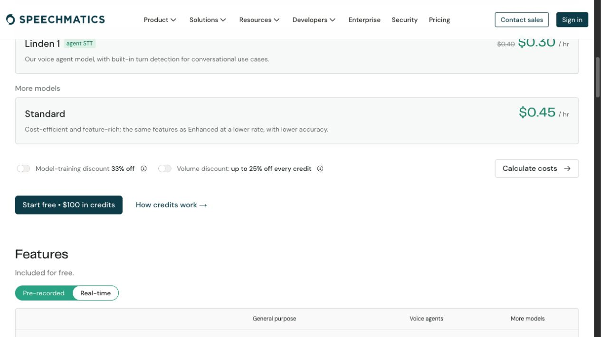

# r85：六模型真实基本范围与实现任务收敛

## 本轮结论

四家六模型均对**同一段5.1675秒虚构英文数字音频+3秒静音**取得真实Partial/Final与有效来源范围。没有重放旧授权；本轮新增D077/078/079各1连接，前三个Deepgram模型来自r84 D075/076。全部实际结果、请求模型/版本未知边界、原始安全日志hash见[six-model-basic-compatibility.json](six-model-basic-compatibility.json)。这关闭“还有三厂商从未真实接通”的缺口，**不关闭重连/多场景效果/全部链路验收**。

| 固定请求模型 | 来源事件 | Partial / Final帧 | 证据 |
|---|---:|---:|---|
| Flux英文 | 18 |17 /1 | r84 D075 |
| Flux多语种 |18 |17 /1 | r84 D076 |
| Nova3英文 |7 |6 /1 | r84 D076 |
| AssemblyAI universal-3-5-pro英文 |13 |12 /1 | assemblyai-D077.jsonl |
| Speechmatics Enhanced英文 |14 |13 /1 | speechmatics-D078.jsonl |
| Soniox stt-rt-v5英文提示 |18 |15 /3 | soniox-D079.jsonl |

每个转写帧missing_reason均为空；每模型有有效归一化段，重复未改变的快照可正常输出空changed-ranges，不能说每帧均产出新段。所有记录段0≤start≤end≤8167.5ms；每模型只1连接，原始处理时间未当采集时钟。表列是固定**请求模型**，转写schema未广告服务器构建号，不能据此虚构实际build版本。语义文本不保证与原文完全一致，不报告未计算的WER或效果通过。

## 探针变更与自测

- 复用正式ASR factory/SDK/SourceNormalizer，新增按厂商的明确互斥scope、独立batch/hash/接收方/Key选择。未授权、数据hash变化或已消费授权在读Key/连接前拒绝。
- AssemblyAI与Soniox连接守卫在原SDK实际_websocket_connect前计数；Speechmatics守卫在RT Transport.connect前，不只包外层Voice client。首次握手后重连拒绝，结束恢复原方法。Speechmatics固定eu2接收方，避免环境URL覆盖把Key送往别处。
- 来源证据仅白名单时间/词/metadata/fragments，保留显式null，排除headers、任意secret。Soniox原生async-generator迭代协议初版不兼容在付费调用前离线发现并红绿修复；不能把最初单元绿当SDK兼容证据。
- Soniox重复快照token也计数，>1000即关连接并禁止继续收发；实际64/1000，未触发。预留1000音频token和4000文字token共US$0.018，**预算预留不是厂商硬计费上限**，用户D079明确知情授权US$0.02预算；实际usage/账单没有返回，不报告确定扣费。
- 当前探针25项通过4.56秒；Ruff/Mypy检查通过，后续只白名单增加start_ms/end_ms字段另以本轮最终定向检查覆盖。业务生产src与frontend/src比r83逐hash无变化，未重复原715后端/25页面检查。红灯与各轮绿灯原日志保留。

## 实现任务核对

[implementation-task-audit.json](implementation-task-audit.json)逐项列实际JUnit用例，并确认r83后生产源hash不变。可核对的8项实现任务M1-2、M3-1/2/3/4/6、M4-1/2已按证据补勾；不把实现完成扩成整个M1/M3/M4或外部效果通过。M3-5默认RTC采用、M1-3跨连接时钟、M4-3设备/AEC、M4-4全范围指标及M5/M6仍保留。

历史“尚未授权/未接入”的前置项仅在有后续D065/D067/D071/r83/r84证据时登记后续关闭；原失败记录保留。r84研发Checkpoint B真实本地API/存储完成，独立C/Gate2未通过，r83独立阶段BLOCKED仍是当时审查结论。

## 当前交付剩余与完成条件

1. **RTC/来源计时**：保留现有RTP，缺少浏览器采集样本→编码RTP→服务器解码/重采样→配置VAD边界的可靠映射；不能用已实现的下行映射倒推。先限定原锁定SDK接口证据和最小接入，任何无法证明仍缺失；不换传输或默认采用。跨连接clock/epoch不得猜。
2. **真实完整兼容**：基本六单例已闭合，真实续说/主动修订/重连、阿语/混说、效果/语速/完整LLM工具取消及TTS其余文本仍未验证。需要的新批次先列确切数据/次数/费用/停止，不复用D075–079。不是再跑已通过同例。
3. **设备与最终回归/审核**：耳机/扬声器/双讲、手机/Safari/弱网、1核1G、部署Python3.11仍缺。候选收敛后执行最终统一回归和独立C，不自签PASS/User Gate2。

## 费用与只读官方核对

D077按AssemblyAI会话时长US$0.45/hr、30秒保守US$0.00375；D078按实时Enhanced无网页报价折扣US$0.80/hr、30秒US$0.00667；D079是token预算预留US$0.018而非usage。各独立授权US$0.02，已全部消费，不重放。没有客户素材、Jev/LLM/TTS或其他未授权服务调用。

官方来源：[AssemblyAI实时产品](https://www.assemblyai.com/products/streaming-speech-to-text)、[Speechmatics价格](https://www.speechmatics.com/pricing)、[Soniox价格](https://soniox.com/pricing)、[Soniox协议](https://soniox.com/docs/api-reference/stt/websocket-api)。Speechmatics网页只切公开报价实时/折扣展示，不登录、不改账号训练/留存；AX和截图speechmatics-price-ax.txt / speechmatics-price.png留证。

## 文件与复现

新增原始日志在scripts/vendor/{assemblyai,speechmatics,soniox}/logs/，均gitignored；白名单jsonl副本在本目录。素材test-results/td-vendor-inputs/20261024/digits-ready.wav忽略且未入源码包。没有新增数据库/实机录音。Key只从忽略.env读取，未输出或保存明文到证据。

离线复核：`.venv/bin/python -m pytest tests/test_td_vendor_probe.py -q`；执行不带--execute的--single-vendor只检查计划/素材，不连接。真实调用需新授权，严禁重跑已消费D077/078/079。Python3.13，依赖以requirements.lock为准。当前源码/自测包见review-package/；独立r83阶段审查不覆盖r85探针增量，完整Change未宣称完成。

## 独立增量审查的计数更正

评审发现报告曾把转写帧与有效更新混称；实际“转写帧→非空归一化事件→段数”为Flux英文18→18→18、多语18→18→18、Nova7→7→7、Assembly13→8→8、Speechmatics14→13→13、Soniox18→18→34。Assembly空帧与前帧text/words时间相同、Speechmatics空帧与前帧text/metadata/fragments相同，是正常changed-ranges去重；Final仍产生新修订，无missing_reason。已修矩阵字段及措辞，不改原始日志、不改生产代码或补收费重跑。旧928文件包保留其审查SHA，修正文档的新版单独封装。

审核包复现：首次错误cwd找不到r85包，后续旧probe运行保留before-cwd-fix-probe-checks.txt，不当本版本证据。已改用绝对包路径解包928文件并逐hash核验，再在/tmp/voiceagent-r85-review-extracted新cwd执行25项通过4.44秒。解包依赖既有锁定Python环境，不证明裸机/3.11。

## 独立阶段增量审查

[preliminary-r85.md](../stage-review/preliminary-r85.md)已完成：独立25项离线4.43秒，授权/计划hash及消费后拒绝、六实包/范围/次数、8任务JUnit/99生产输入hash已核对。唯一计数措辞发现已修正并独立只读复核；未发现新增实现缺陷。全Change仍BLOCKED，非最终C/UserGate2。原928包保留其SHA，当前修正文档另封review-package-v2，不覆盖旧输入。

临时封包/文档辅助脚本在/tmp/td_r85_*.py，新目录/tmp/voiceagent-r85-review-extracted保留复现依据；原错误cwd结果与旧包均保留，不提交这些临时目录。修正文档v2包经929文件逐hash核验，src/frontend/scripts/tests与独立已检版本hash完全一致，未重复同类测试。
